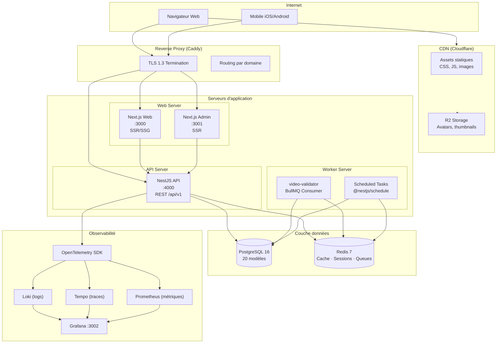
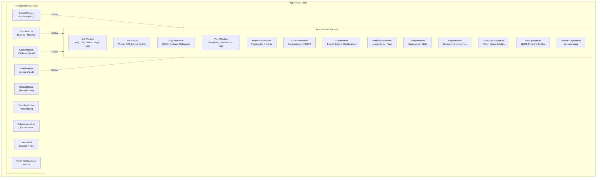
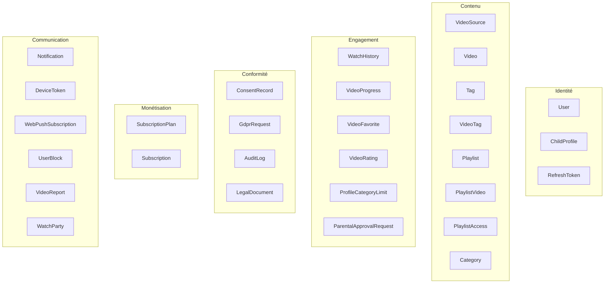
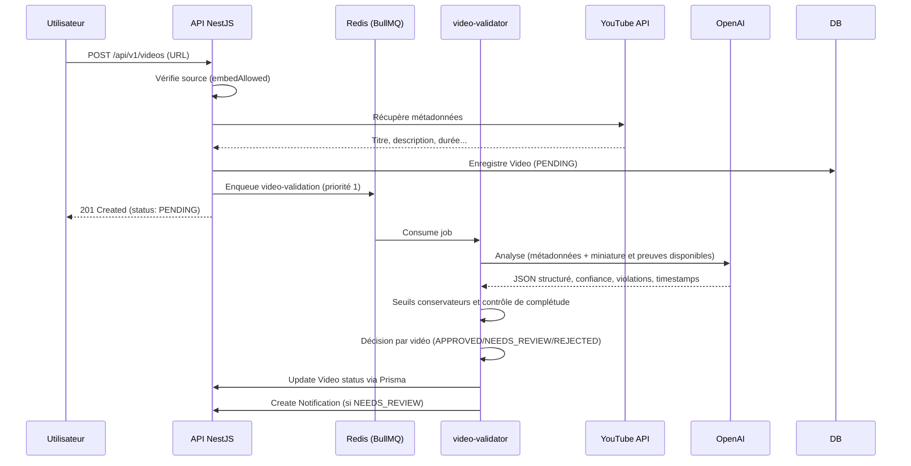
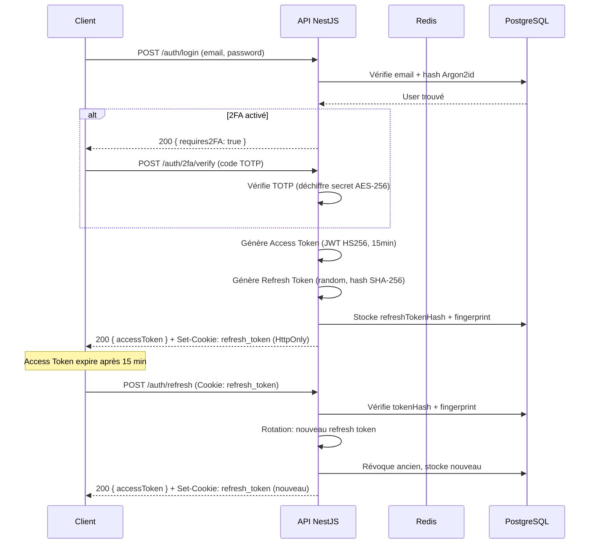
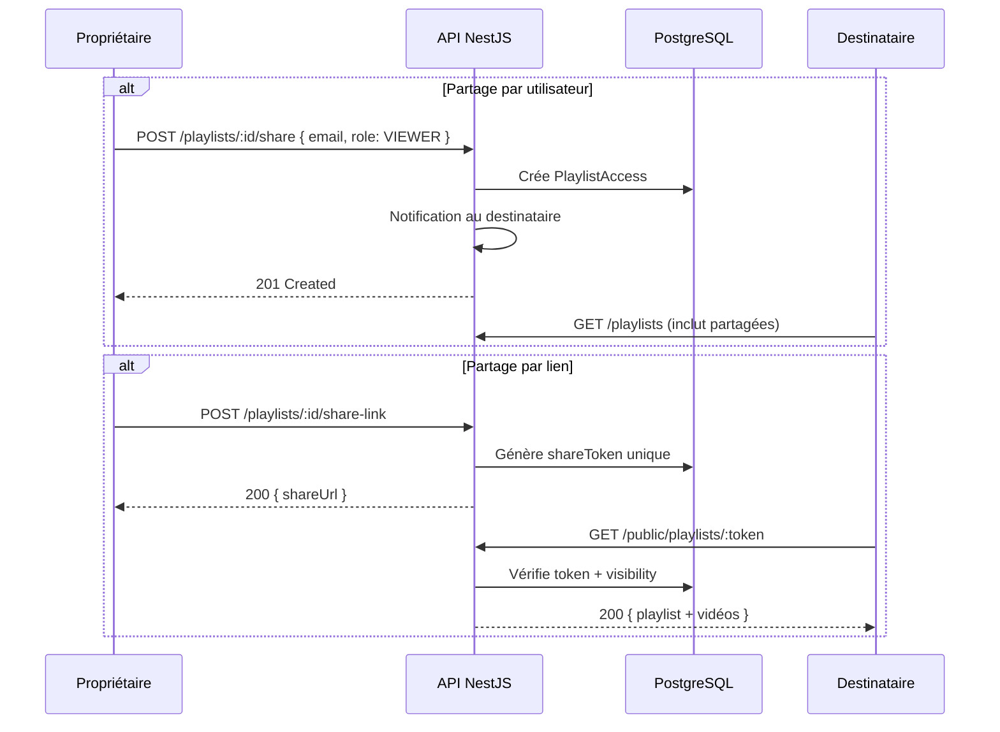

# Architecture Système — NourPlay

> Document de référence décrivant l'architecture logicielle complète  
> Version : 1.0 — Dernière mise à jour : 20 août 2026

---

## 1. Vue d'ensemble

NourPlay est une plateforme de curation vidéo organisée en **monorepo** (Turborepo + pnpm workspaces) avec une architecture **modulaire monolithique** côté backend et des **applications front-end indépendantes**.

### Principes architecturaux

| Principe | Application |
|----------|------------|
| **Monorepo** | Tout le code dans un seul dépôt, avec des workspaces pnpm et Turborepo pour le parallélisme |
| **Monolithe modulaire** | Un seul processus NestJS avec des modules bien découpés, pas de micro-services prématurés |
| **Separation of concerns** | Front-end, backend, workers, et base de données sont des couches distinctes |
| **API-first** | Toutes les applications communiquent via l'API REST versionnée |
| **Privacy by design** | Conformité RGPD intégrée dans chaque module |
| **Type-safety** | TypeScript bout-en-bout, types Prisma partagés |

---

## 2. Diagramme de déploiement



---

## 3. Structure du monorepo

```
nourplay/
├── apps/                          # Applications front-end
│   ├── web/                       # Interface parent/enseignant (Next.js 14)
│   ├── admin/                     # Back-office administrateur (Next.js 14)
│   └── mobile/                    # App iOS/Android (Expo 53)
│
├── packages/                      # Packages partagés
│   ├── api/                       # API NestJS (backend)
│   ├── db/                        # Prisma (schéma + migrations + seed)
│   ├── i18n/                      # Configuration next-intl
│   └── ui/                        # Composants React partagés
│
├── workers/                       # Workers asynchrones
│   └── video-validator/           # Pipeline de validation IA (BullMQ)
│
├── docs/                          # Documentation
│   ├── phases/                    # Documentation par phase (29 docs)
│   ├── architecture/              # Architecture technique
│   └── compliance/                # RGPD, CNIL, conformité
│
├── scripts/                       # Scripts utilitaires
│   ├── db/                        # Scripts SQL (init.sql)
│   └── observability/             # Config Grafana, Prometheus, Tempo
│
├── .github/workflows/             # CI/CD
│   └── ci.yml                     # Pipeline CI (6 jobs)
│
├── docker-compose.yml             # Infra de développement
├── docker-compose.prod.yml        # Infra de production
├── turbo.json                     # Configuration Turborepo
├── pnpm-workspace.yaml            # Workspaces pnpm
└── tsconfig.base.json             # TypeScript base partagé
```

---

## 4. Architecture backend — Modules NestJS

### Diagramme des modules



### Responsabilités par module

| Module | Responsabilité | Dépendances |
|--------|---------------|-------------|
| **PrismaModule** (global) | Client Prisma, connection pooling, hooks | — |
| **BullModule** (global) | Configuration BullMQ, connexion Redis | — |
| **EmailModule** (global) | Envoi d'emails via Resend ou MailHog (dev) | ConfigModule |
| **RedisTokenModule** (global) | Client ioredis pour blacklist tokens | ConfigModule |
| **CacheModule** (global) | Cache applicatif générique (get/set/del) wrapping ioredis | RedisTokenModule |
| **AuditModule** (global) | Écriture dans audit_logs (insert-only) | PrismaModule |
| **AuthModule** | Register, login, logout, refresh, verify email, forgot/reset password, 2FA TOTP, OAuth Google, magic link | PrismaModule, EmailModule, RedisTokenModule |
| **UserModule** | CRUD profils enfants, PIN verify, blocks, watch history, favorites, progress, stats, avatar | PrismaModule, StorageModule |
| **PlaylistModule** | CRUD playlists, ajout/retrait vidéos, réordonnement, partage (par user + par lien), catégories | PrismaModule, NotificationModule |
| **VideoModule** | Soumission URL, extraction métadonnées (YouTube/Vimeo API), recherche avancée, tags, reporting | PrismaModule, BullModule |
| **ModerationModule** | File de modération, approve/reject, résolution signalements | PrismaModule, NotificationModule |
| **ConsentModule** | Enregistrement/révocation consentements, historique | PrismaModule |
| **GdprModule** | Export données (my-data), demande export/delete/rectification, admin stats | PrismaModule |
| **NotificationModule** | CRUD notifications, push Expo, push web (VAPID), email | PrismaModule, EmailModule |
| **AdminModule** | Gestion utilisateurs, rôles, audit logs, stats agrégées | PrismaModule |
| **LegalModule** | CRUD documents légaux versionnés (CGU, politique confidentialité) | PrismaModule |
| **SubscriptionModule** | Plans, checkout Stripe, webhooks, limites par plan, tâches cron (expiration, rappels) | PrismaModule, CacheModule, NotificationModule, EmailModule |
| **StorageModule** | Presigned URLs S3/R2, upload/delete avatars | ConfigModule |
| **WatchPartyModule** | Création/jointure de sessions de co-visionnage | PrismaModule |

### Couches transversales

| Couche | Éléments | Fichiers |
|--------|----------|---------|
| **Guards** | `JwtAuthGuard` (Passport JWT), `RolesGuard` (RBAC) | `common/guards/` |
| **Decorators** | `@Public()`, `@Roles()`, `@CurrentUser()` | `common/decorators/` |
| **Interceptors** | Logging, transformation de réponse | `common/interceptors/` |
| **Filters** | Exception filter global (format erreurs standardisé) | `common/filters/` |
| **Pipes** | `ValidationPipe` global (whitelist, transform) | `main.ts` |

---

## 5. Architecture front-end

### 5.1. Web (Next.js 14 App Router)

```
apps/web/src/
├── app/[locale]/
│   ├── (auth)/                # Routes publiques : login, register, verify, reset
│   ├── (dashboard)/           # Routes protégées parent/enseignant
│   │   ├── playlists/         # CRUD playlists
│   │   ├── videos/            # Vidéothèque, soumission
│   │   ├── profiles/          # Gestion profils enfants
│   │   ├── account/           # Paramètres compte, 2FA, consentements
│   │   ├── subscription/      # Abonnement Stripe
│   │   ├── approvals/         # File d'approbation parentale
│   │   ├── admin/             # Admin (si rôle ADMIN)
│   │   └── watch-party/       # Co-visionnage
│   ├── (child)/               # Interface enfant (accès restreint)
│   │   ├── playlists/         # Playlists autorisées
│   │   ├── favorites/         # Vidéos favorites
│   │   ├── history/           # Historique
│   │   └── watch/             # Lecteur vidéo
│   └── shared/                # Playlist partagée par lien
├── components/                # Composants React (VideoPlayer, PinModal, etc.)
├── hooks/                     # Hooks (useAuth, useChildSession, useApi)
├── lib/                       # Client API typé, utilitaires
├── i18n/                      # Configuration next-intl
└── middleware.ts              # Auth + locale detection
```

**Routing** : App Router Next.js 14 avec route groups :
- `(auth)` : routes publiques d'authentification
- `(dashboard)` : routes protégées par le JWT
- `(child)` : routes du mode enfant (vérifié par PIN côté client)

**I18n** : next-intl avec 4 locales (fr, en, ar, es), RTL natif pour l'arabe.

**Styling** : Tailwind CSS 3 avec un design system cohérent.

### 5.2. Admin (Next.js 14 App Router)

```
apps/admin/src/app/
├── dashboard/
│   ├── users/                 # Gestion utilisateurs (liste, détail, rôle)
│   ├── moderation/            # File de modération + signalements
│   ├── audit/                 # Journal d'audit
│   ├── gdpr/                  # Dashboard conformité RGPD
│   └── subscriptions/         # Gestion des plans et abonnements
└── login/                     # Authentification admin
```

### 5.3. Mobile (Expo 53 / React Native 0.79)

```
apps/mobile/src/
├── screens/                   # Écrans React Native
│   ├── LoginScreen.tsx
│   ├── ProfileSelectScreen.tsx
│   ├── ParentHomeScreen.tsx
│   ├── ParentPlaylistsScreen.tsx
│   ├── ParentVideosScreen.tsx
│   ├── ParentAccountScreen.tsx
│   ├── ChildHomeScreen.tsx
│   └── ChildWatchScreen.tsx
├── navigation/                # React Navigation (tabs + stack)
├── components/                # Composants natifs
├── hooks/                     # Hooks personnalisés
└── api/                       # Client API
    └── api.ts                 # Fetcher avec gestion tokens
```

**Navigation** : React Navigation avec un bottom tab navigator (4 onglets parent, 3 onglets enfant).

**Tests E2E** : Maestro (compatible Expo managed workflow) avec 4 flows de test.

---

## 6. Architecture des données

### 6.1. PostgreSQL 16

**20 modèles** Prisma organisés en 7 domaines :



### 6.2. Redis 7

| Utilisation | Clé pattern | TTL |
|------------|-------------|-----|
| **Blacklist JWT** | `bl:<tokenHash>` | Durée restante du token |
| **Cache applicatif** | `cache:<entity>:<id>` | Configurable (ex: 5 min) |
| **Limites abonnement** | `sub:limits:<userId>` | 5 min |
| **BullMQ queues** | `bull:<queueName>:*` | Automatique |
| **Rate limiting** | Géré par ThrottlerModule (stockage Redis) | Configurable |

### 6.3. S3 / Cloudflare R2

| Utilisation | Bucket | Accès |
|-------------|--------|-------|
| Avatars utilisateurs/enfants | `nourplay-assets/avatars/` | Presigned URL (upload direct) |
| Exports GDPR | `nourplay-assets/exports/` | URL signée TTL 24h |
| Thumbnails customs | `nourplay-assets/thumbnails/` | Public via CDN |

> **Règle fondamentale** : aucune vidéo n'est stockée sur S3. Les vidéos restent sur leurs plateformes d'hébergement d'origine.

---

## 7. Architecture des workers

### 7.1. Worker video-validator



Les vidéos importées depuis une playlist suivent le même flux individuellement après la création transactionnelle de la playlist. La playlist est résumée à partir des statuts réels de ses vidéos. Les métadonnées et une miniature seules entraînent une revue humaine, pas une approbation automatique; l'analyse audio/vidéo complète nécessite des preuves média préparées séparément.

### 7.2. Tâches planifiées (@nestjs/schedule)

| Tâche | Cron | Logique |
|-------|------|---------|
| `sendExpiryReminders` | `0 10 * * *` (10h) | Envoie email + notification push 7j avant expiration abonnement |
| `markExpiredSubscriptions` | `0 2 * * *` (02h) | Passe les abonnements expirés en status `EXPIRED`, invalide le cache |

---

## 8. Flux d'authentification



---

## 9. Flux de partage de playlist



---

## 10. Décisions d'architecture

### ADR-001 : Monolithe modulaire plutôt que micro-services

**Contexte** : Le projet démarre avec une équipe réduite.  
**Décision** : NestJS en monolithe modulaire avec des modules bien découplés.  
**Justification** : Complexité opérationnelle réduite, debugging simplifié, déploiement unique. Les modules sont suffisamment découplés pour être extraits en services indépendants ultérieurement si nécessaire.  
**Conséquences** : Un seul processus API, un seul déploiement, une seule base de données.

### ADR-002 : REST plutôt que GraphQL

**Contexte** : ~85 endpoints CRUD classiques.  
**Décision** : API REST versionnée (`/api/v1/`).  
**Justification** : Cache HTTP natif, rate limiting simple par route, Swagger auto-généré, payloads prévisibles pour le mobile.  
**Conséquences** : Pas de requêtes flexibles côté client (over-fetching possible mais acceptable).

### ADR-003 : Argon2id plutôt que bcrypt

**Contexte** : Hachage des mots de passe et PINs enfants.  
**Décision** : Argon2id (64 MB mémoire, 3 itérations, parallélisme 1).  
**Justification** : Winner du Password Hashing Competition, résistant aux attaques GPU et ASIC (memory-hard), recommandé par l'OWASP.  
**Conséquences** : Consommation mémoire plus élevée par hash (64 MB), acceptable pour un serveur.

### ADR-004 : Prisma plutôt que TypeORM

**Contexte** : ORM TypeScript pour PostgreSQL.  
**Décision** : Prisma 5.  
**Justification** : Type-safety bout-en-bout (types auto-générés), migrations déclaratives versionnées, introspection de schéma, Prisma Studio pour le debugging.  
**Conséquences** : Dépendance au client Prisma généré, certaines requêtes complexes nécessitent `$queryRaw`.

### ADR-005 : BullMQ plutôt que traitements synchrones

**Contexte** : Validation IA, envoi d'emails, exports GDPR.  
**Décision** : BullMQ via Redis pour les tâches asynchrones.  
**Justification** : Découple le traitement long de la réponse API, retry automatique, priorité des jobs, monitoring via Bull Board.  
**Conséquences** : Dépendance à Redis, worker séparé à maintenir.

### ADR-006 : Expo managed workflow plutôt que bare workflow

**Contexte** : Application mobile iOS/Android.  
**Décision** : Expo 53 en managed workflow.  
**Justification** : OTA updates, build cloud (EAS), pas besoin de Xcode/Android Studio localement, 90% des besoins couverts par les modules Expo.  
**Conséquences** : Pas de support TV natif (nécessite react-native-tvos, incompatible managed workflow). Tests E2E avec Maestro au lieu de Detox.

### ADR-007 : Maestro plutôt que Detox pour les tests E2E mobile

**Contexte** : Tests E2E sur l'application Expo.  
**Décision** : Maestro avec des flows YAML.  
**Justification** : Compatible Expo managed workflow (Detox nécessite un eject), syntaxe YAML simple, pas de dépendance à Xcode/Android Studio.  
**Conséquences** : Moins de contrôle que Detox, mais suffisant pour les scénarios de test clés.
