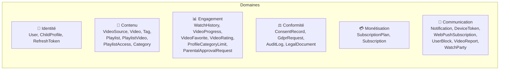

# Modèle de données — Documentation détaillée

> Référence complète du schéma Prisma NourPlay  
> Version : 1.0 — 20 modèles, 12 enums

---

## Vue d'ensemble



---

## Enums

### Rôles et statuts

| Enum | Valeurs | Usage |
|------|---------|-------|
| `UserRole` | PARENT, TEACHER, MODERATOR, ADMIN | Rôle RBAC de l'utilisateur |
| `AgeGroup` | AGE_0_3, AGE_4_6, AGE_7_9, AGE_10_12, AGE_13_15 | Groupe d'âge du profil enfant |
| `AgeRating` | ALL, AGE_4_PLUS, AGE_7_PLUS, AGE_10_PLUS, AGE_13_PLUS | Classification d'âge de la vidéo |
| `VideoValidationStatus` | PENDING, APPROVED, REJECTED, NEEDS_REVIEW | Statut de validation IA de la vidéo |
| `ApprovalStatus` | PENDING, APPROVED, DENIED | Statut d'approbation parentale |

### Playlists et partage

| Enum | Valeurs | Usage |
|------|---------|-------|
| `PlaylistVisibility` | PRIVATE, SHARED_LINK, SHARED_USERS | Niveau de visibilité de la playlist |
| `PlaylistAccessRole` | VIEWER, EDITOR | Permission de l'utilisateur sur une playlist partagée |

### Données personnelles

| Enum | Valeurs | Usage |
|------|---------|-------|
| `ConsentType` | TERMS, PRIVACY, COOKIE_ANALYTICS, COOKIE_FUNCTIONAL, PARENTAL_CONSENT | Type de consentement RGPD |
| `GdprRequestType` | EXPORT, DELETE, RECTIFICATION | Type de demande RGPD |
| `GdprRequestStatus` | PENDING, PROCESSING, COMPLETED, REJECTED | Statut de traitement de la demande |

### Engagement

| Enum | Valeurs | Usage |
|------|---------|-------|
| `BlockType` | CHANNEL_WHITELIST, CHANNEL_BLACKLIST, KEYWORD_BLACKLIST, KEYWORD_WHITELIST | Type de filtre de contenu |
| `VideoRatingValue` | THUMBS_UP, THUMBS_DOWN | Évaluation d'une vidéo par un enfant |

### Monétisation

| Enum | Valeurs | Usage |
|------|---------|-------|
| `SubscriptionStatus` | ACTIVE, CANCELLED, PAST_DUE, TRIALING, EXPIRED | Statut de l'abonnement |
| `PlanInterval` | MONTHLY, YEARLY | Période de facturation |

---

## Modèles par domaine

### 🔐 Identité

#### User (`users`)

Centre du modèle — un utilisateur adulte avec authentification multi-méthode.

| Champ | Type | Contraintes | Notes |
|-------|------|------------|-------|
| `id` | UUID | PK, auto-généré | — |
| `email` | String | UNIQUE, INDEX | Identifiant principal |
| `passwordHash` | String? | — | Nullable (OAuth users) |
| `role` | UserRole | Default: PARENT | RBAC |
| `emailVerified` | Boolean | Default: false | Validation email |
| `emailVerifiedAt` | DateTime? | — | Horodatage validation |
| `twoFactorEnabled` | Boolean | Default: false | — |
| `twoFactorSecret` | String? | — | Chiffré AES-256 |
| `googleId` | String? | UNIQUE | OAuth Google |
| `locale` | String | Default: "fr" | Préférence langue |
| `weeklyDigestEnabled` | Boolean | Default: true | Opt-in digest |
| `stripeCustomerId` | String? | UNIQUE | Référence Stripe |
| `createdAt` | DateTime | auto | — |
| `updatedAt` | DateTime | auto | — |
| `deletedAt` | DateTime? | INDEX | Soft delete RGPD |

**Relations** : ChildProfile (1:N), Playlist (1:N), PlaylistAccess (1:N), RefreshToken (1:N), ConsentRecord (1:N), AuditLog (1:N), UserBlock (1:N), Notification (1:N), GdprRequest (1:N), VideoReport (1:N), Subscription (1:1), DeviceToken (1:N), WebPushSubscription (1:N), WatchParty (1:N), LegalDocument (1:N)

---

#### ChildProfile (`child_profiles`)

Profil enfant rattaché à un parent — pas un compte indépendant.

| Champ | Type | Contraintes | Notes |
|-------|------|------------|-------|
| `id` | UUID | PK | — |
| `userId` | UUID | FK → User, INDEX | Parent propriétaire |
| `displayName` | String | — | Prénom ou pseudo |
| `birthYear` | Int? | — | **Minimisé** : année seule |
| `ageGroup` | AgeGroup | — | Filtrage contenu |
| `avatarKey` | String? | — | Clé S3 (pas URL) |
| `pinHash` | String | — | Argon2id |
| `viewingSchedule` | Json? | — | `{"mon":["08:00-12:00"]}` |
| `dailyLimitMin` | Int? | — | Minutes/jour |
| `sessionLimitMin` | Int? | — | Minutes/session |
| `deletedAt` | DateTime? | — | Soft delete |

**Relations** : User (N:1), WatchHistory (1:N), VideoFavorite (1:N), VideoProgress (1:N), VideoRating (1:N), ProfileCategoryLimit (1:N), ParentalApprovalRequest (1:N)

**Suppression** : CASCADE depuis User (le profil est supprimé avec le compte parent).

---

#### RefreshToken (`refresh_tokens`)

Tokens de rafraîchissement JWT avec rotation et fingerprinting.

| Champ | Type | Contraintes | Notes |
|-------|------|------------|-------|
| `id` | UUID | PK | — |
| `userId` | UUID | FK → User, INDEX | — |
| `tokenHash` | String | UNIQUE, INDEX | SHA-256 du token brut |
| `fingerprint` | String | — | Hash UA + IP subnet |
| `expiresAt` | DateTime | — | TTL 7 jours par défaut |
| `revokedAt` | DateTime? | — | Null = actif |

**Sécurité** : le token brut n'est jamais stocké en base. Seul le hash SHA-256 est persisté.

---

### 🎥 Contenu

#### VideoSource (`video_sources`)

Configuration des plateformes d'hébergement vidéo autorisées.

| Champ | Type | Contraintes | Notes |
|-------|------|------------|-------|
| `id` | UUID | PK | — |
| `name` | String | UNIQUE | "YouTube", "Vimeo" |
| `slug` | String | UNIQUE | "youtube", "vimeo" |
| `baseUrl` | String | — | URL de base |
| `embedAllowed` | Boolean | Default: false | CGU autorisent l'embed ? |
| `cguVersion` | String? | — | Version des CGU vérifiées |
| `cguCheckedAt` | DateTime? | — | Date de vérification |
| `embedPolicy` | Json? | — | Règles d'embed parsées |
| `isActive` | Boolean | Default: true | Source active ? |

**Rôle conformité** : chaque source est vérifiée pour s'assurer que ses CGU autorisent l'embed. Les vidéos d'une source avec `embedAllowed=false` sont bloquées à la soumission.

---

#### Video (`videos`)

Métadonnées d'une vidéo hébergée sur une plateforme tierce.

| Champ | Type | Contraintes | Notes |
|-------|------|------------|-------|
| `id` | UUID | PK | — |
| `sourceId` | UUID | FK → VideoSource | — |
| `externalId` | String | — | ID sur la plateforme |
| `embedUrl` | String | — | URL d'intégration |
| `title` | String | — | Titre de la vidéo |
| `description` | String? | — | Description |
| `durationSec` | Int? | — | Durée en secondes |
| `thumbnailUrl` | String? | — | URL miniature |
| `language` | String? | INDEX | Langue de la vidéo |
| `ageRating` | AgeRating | Default: ALL, INDEX | Classification |
| `validationStatus` | VideoValidationStatus | Default: PENDING, INDEX | Statut IA |
| `validationScore` | Float? | — | Score 0.0→1.0 |
| `validationLog` | Json? | — | Détail analyse IA |
| `publishedAt` | DateTime? | — | Date publication source |
| `submittedById` | UUID? | — | Utilisateur soumetteur |
| `submitterApprovedAt` | DateTime? | — | Date d'une relance manuelle facultative par le soumetteur ; l'analyse IA démarre automatiquement à la soumission |

**Contrainte unique** : `(sourceId, externalId)` — pas de doublon par plateforme.

**Visibilité** : seules les vidéos `APPROVED` sont visibles dans les playlists partagées et l'interface enfant.

---

#### Playlist (`playlists`)

Collection ordonnée de vidéos créée par un adulte.

| Champ | Type | Contraintes | Notes |
|-------|------|------------|-------|
| `id` | UUID | PK | — |
| `ownerId` | UUID | FK → User, INDEX | Propriétaire |
| `name` | String | — | Nom de la playlist |
| `description` | String? | — | Description |
| `visibility` | PlaylistVisibility | Default: PRIVATE, INDEX | Niveau de partage |
| `targetAgeGroup` | AgeGroup[] | — | Groupes d'âge cibles |
| `languages` | String[] | — | Langues des vidéos |
| `shareToken` | String? | UNIQUE | Token de partage par lien |
| `scheduledPublishAt` | DateTime? | — | Publication planifiée |
| `deletedAt` | DateTime? | — | Soft delete |

---

### ⚖️ Conformité

#### ConsentRecord (`consent_records`)

Preuve horodatée de chaque consentement donné ou révoqué.

| Champ | Type | Contraintes | Notes |
|-------|------|------------|-------|
| `id` | UUID | PK | — |
| `userId` | UUID | FK → User | — |
| `type` | ConsentType | INDEX (userId, type) | Type de consentement |
| `version` | String | — | Version du texte (ex: "2026-01-01") |
| `consentedAt` | DateTime | auto | Horodatage |
| `ipHash` | String | — | SHA-256 de l'IP (non réversible) |
| `userAgent` | String? | — | Navigateur |
| `revokedAt` | DateTime? | — | Null = actif |

**Durée de conservation** : permanente (obligation légale de conserver la preuve du consentement).

---

#### AuditLog (`audit_logs`)

Journal d'audit immuable — **insert-only**, aucun UPDATE ni DELETE autorisé.

| Champ | Type | Contraintes | Notes |
|-------|------|------------|-------|
| `id` | UUID | PK | — |
| `actorId` | UUID? | FK → User, INDEX | Null = action système |
| `actorRole` | String? | — | Rôle au moment de l'action |
| `action` | String | INDEX | Ex: "video.approve" |
| `resourceType` | String | — | Ex: "Video", "User" |
| `resourceId` | String? | — | ID de la ressource |
| `metadata` | Json? | — | Données contextuelles |
| `ip` | String? | — | IP de l'acteur |
| `userAgent` | String? | — | Navigateur |
| `occurredAt` | DateTime | INDEX, auto | Horodatage |

---

## Indexation

### Index clés pour les performances

| Table | Index | Justification |
|-------|-------|---------------|
| `users` | `email`, `deletedAt` | Recherche par email, filtrage soft-deleted |
| `child_profiles` | `userId` | Listing des profils par parent |
| `refresh_tokens` | `userId`, `tokenHash` | Lookup par token, nettoyage par utilisateur |
| `videos` | `validationStatus`, `language`, `ageRating` | Recherche et filtrage |
| `videos` | `(sourceId, externalId)` UNIQUE | Dédoublonnage |
| `playlists` | `ownerId`, `visibility` | Listing par propriétaire |
| `playlist_videos` | `(playlistId, position)` | Ordonnement |
| `watch_history` | `(profileId, watchedAt)` | Historique chronologique |
| `consent_records` | `(userId, type)` | Lookup du consentement actif |
| `audit_logs` | `actorId`, `action`, `occurredAt` | Recherche dans l'audit |
| `gdpr_requests` | `userId`, `status` | File d'attente admin |

---

## Migrations

Les migrations Prisma sont versionnées dans `packages/db/prisma/migrations/`. Chaque migration est un dossier contenant un fichier SQL et un fichier de métadonnées.

```bash
pnpm db:migrate          # Appliquer en dev (crée la migration si nécessaire)
pnpm db:migrate:prod     # Appliquer en production (deploy uniquement)
pnpm db:studio           # Interface visuelle de la BDD
```

Le client Prisma est auto-généré dans `packages/db/generated/client/` et est importé par tous les modules via `@nourplay/db`.
